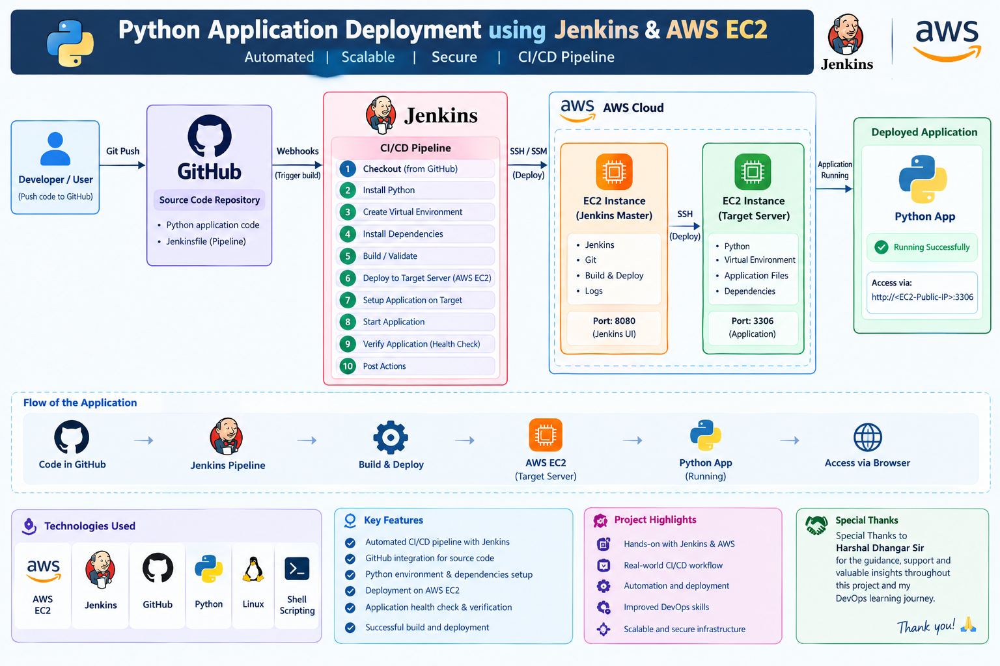
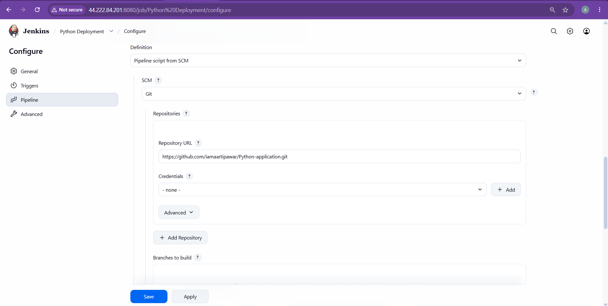
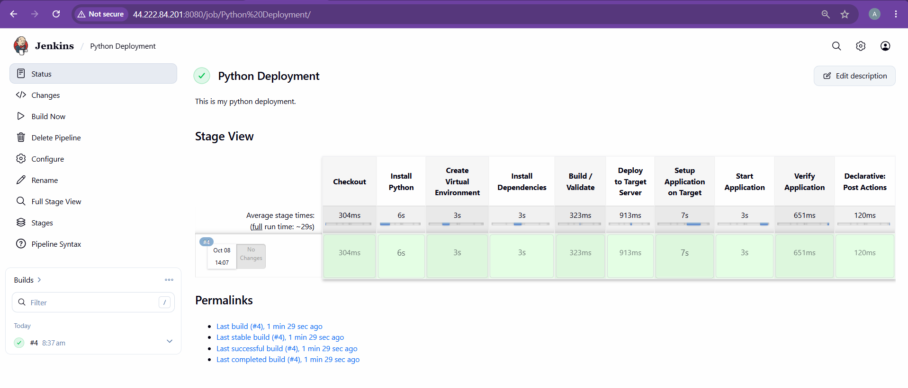
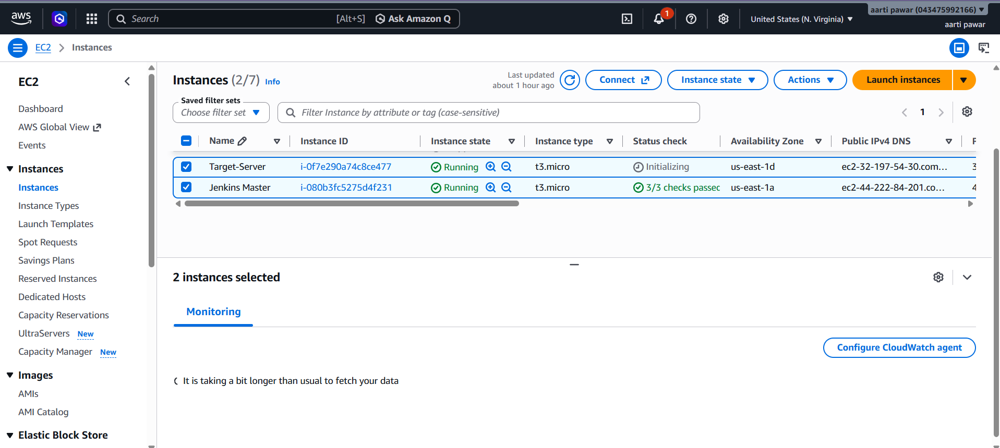
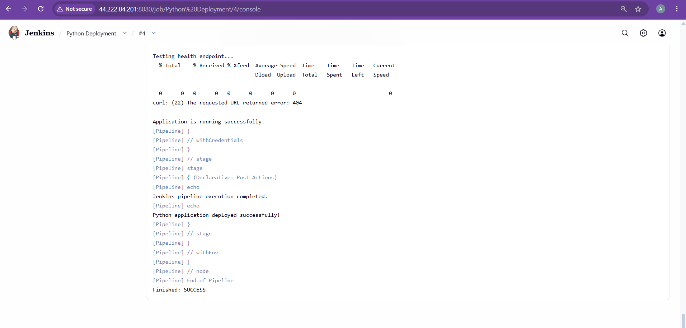
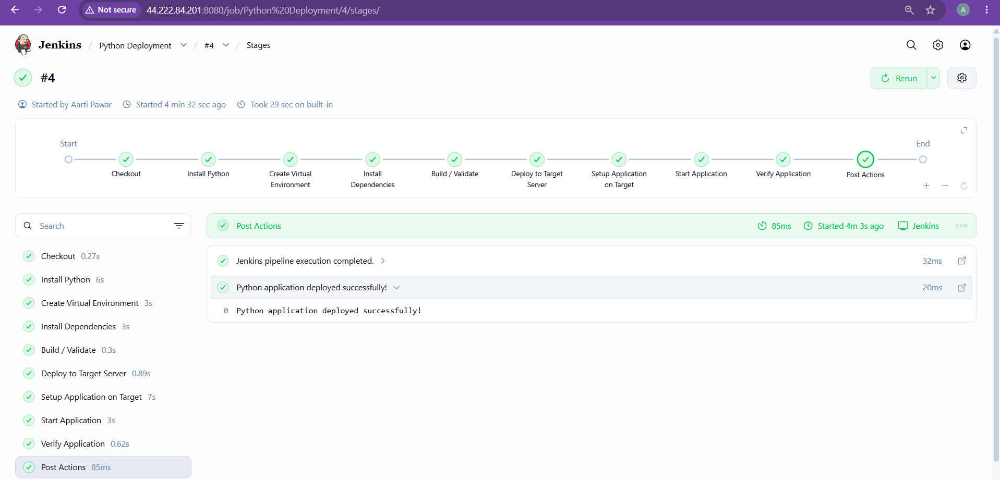
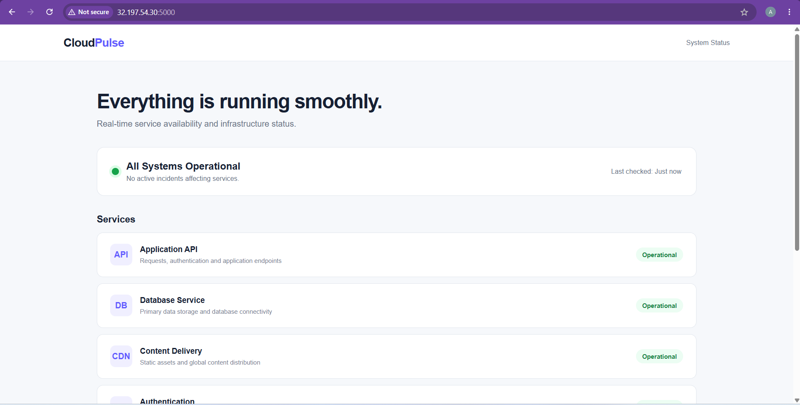

# **🚀 Python Application Deployment using Jenkins & AWS EC2**

## **📌 Project Overview**
This project demonstrates the automated deployment of a Python application using Jenkins CI/CD Pipeline and AWS EC2.

The pipeline automatically fetches the application code from GitHub, sets up the Python environment, installs dependencies, validates the application, deploys it to a target EC2 server, starts the application, and performs a health check.

This project provides hands-on experience with Jenkins Pipeline, GitHub integration, AWS EC2, Python, Linux, and CI/CD automation. It helped me understand how DevOps tools work together to automate the application deployment process and ensure a reliable and repeatable deployment workflow.

## **🏗️ Architecture**
```
GitHub Repository
        ↓
     Jenkins
        ↓
  CI/CD Pipeline
        ↓
   Target EC2
        ↓
 Python Application
        ↓
 Application Verification

 ```

 <p align="center">
  
</p>

## **🔄 Jenkins Pipeline Stages**

The Jenkins pipeline contains the following stages:

1. **Checkout** – Fetches the Python application from GitHub.
2. **Install Python** – Installs/configures Python on the target server.
3. **Create Virtual Environment** – Creates an isolated Python environment.
4. **Install Dependencies** – Installs the required Python packages.
5. **Build / Validate** – Validates the application before deployment.
6. **Deploy to Target Server** – Deploys the application to AWS EC2.
7. **Setup Application on Target** – Configures the application on the target server.
8. **Start Application** – Starts the Python application.
9. **Verify Application** – Performs a health check to verify the application.
10. **Post Actions** – Displays the deployment completion status.

<p align="center">
  
</p>

```
Github Repo URL: https://github.com/iamaartipawar/Python-application
```

<p align="center">
  
</p>

```
The deployment completion status.
```


## **🛠️ Technologies Used**

- **AWS EC2**
- **Jenkins**
- **Git & GitHub**
- **Python**
- **Linux**
- **CI/CD**
- **Shell Scripting**

## **☁️ AWS Infrastructure**

### Jenkins Master
Jenkins is hosted on an AWS EC2 instance and is responsible for executing the CI/CD pipeline.

### Target Server
A separate AWS EC2 instance is used as the target server where the Python application is deployed and executed.

<p align="center">
  
</p>


## **✅ Deployment Result**

The Jenkins pipeline completed successfully with all stages passing.

**Build Status:** `SUCCESS` ✅

<p align="center">
  
</p>

<p align="center">
  

## **Run Application On Browser**

- Target-Server IP:500

</p><p align="center">
  
</p>


The Python application was successfully deployed and verified on the target EC2 server.


## **🎯 Key Learnings**

Through this project, I gained practical experience in:

- Creating Jenkins Declarative Pipelines
- Integrating GitHub with Jenkins
- Automating application deployment
- Working with AWS EC2 instances
- Managing Python virtual environments
- Installing application dependencies
- Performing application health checks
- Understanding CI/CD workflow

## **📌 Project Overview**
This project demonstrates the automated deployment of a Python application using Jenkins and AWS EC2. The application source code is managed through GitHub, while Jenkins automates the complete CI/CD process—from code checkout and Python environment setup to dependency installation, validation, deployment, application startup, and health verification on the target EC2 server.

The project provides hands-on experience with Jenkins Pipeline, GitHub, AWS EC2, Python, Linux, and CI/CD automation, showing how a Python application can be deployed efficiently through an automated DevOps workflow.

**👩‍💻 Author: Aarti Pawar | Aspiring DevOps Engineer**